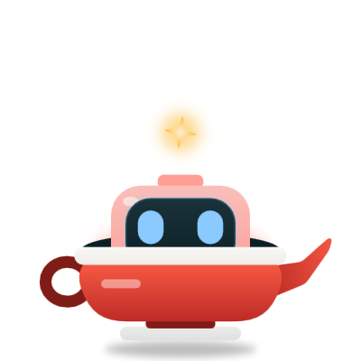
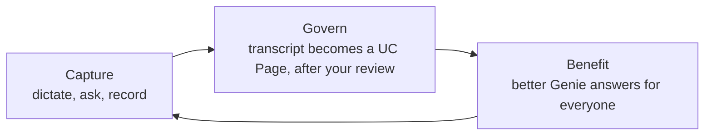
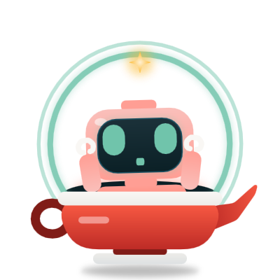
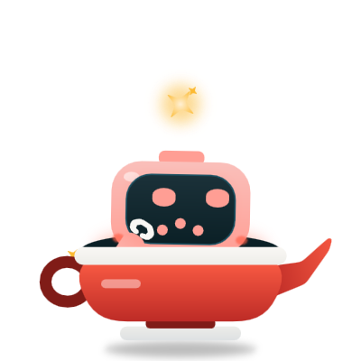
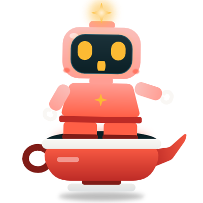
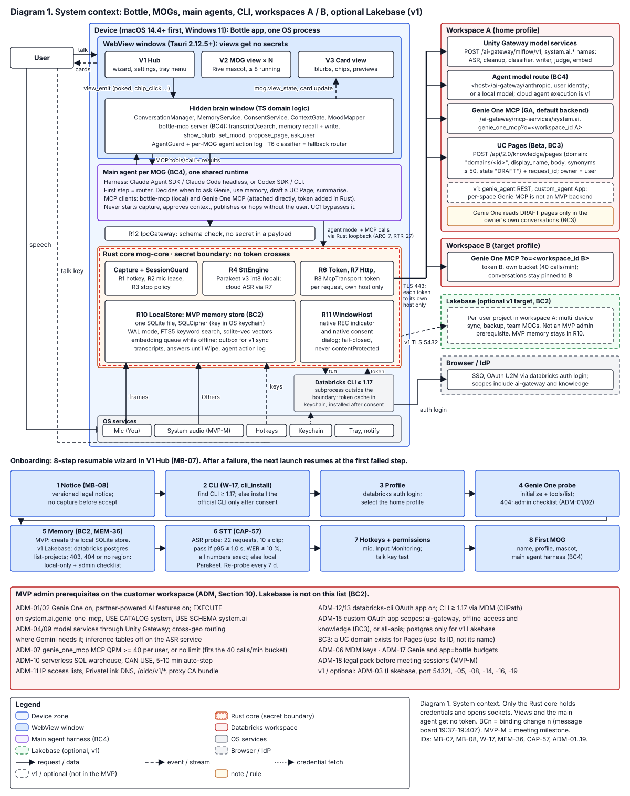
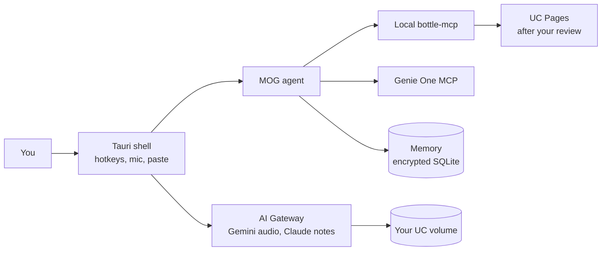

# Bottle: your team's know-how, in every Genie answer

  

**Ship in a bottle.**

Bottle turns your team's unwritten know-how into governed context that every Genie answer can use. It is captured where the work happens, approved by you, and shared with everyone.

Bottle is a small desktop app for Databricks users. It puts a floating Genie, called a MOG, on your screen. You talk to it. It talks to your governed data. It also learns what your team knows, with your approval.

This page explains what Bottle is and where it is going. Some parts ship today. Some are planned. Each planned part is marked inline, and the box "Where we are today" near the end lists all of them.

## 1. The problem

The answers live in Databricks. The questions come up somewhere else.

- A number comes up in a meeting.
- A question comes up in Slack.
- A doubt comes up in the middle of a document.

So people switch to a browser. They lose their place. The context is gone before the answer arrives.

There is a second loss, and it is larger. The know-how that makes data useful is never written down. Somebody says "an active user is anyone who logged in this month". The call ends. Nobody keeps it. The glossary stays empty, Genie cannot find the definition, and the next team defines it again.

## 2. The vision: a knowledge flywheel

Bottle exists to help you get better by turning your unwritten know-how into context that everyone can learn from. You add to the Genie ontology as you work. You also benefit from what others added.

The flywheel has three steps.

1. **Capture.** Calls are recorded and turned into full transcripts with speakers. Dictation and questions also capture know-how where the work happens.
2. **Govern.** Each transcript becomes a Unity Catalog (UC) Page in your domain, through the UC Pages API. You review it first. (Planned.)
3. **Benefit.** Genie finds and uses those Pages for everyone, so every answer, yours and your colleagues', gets better. Using Bottle makes it more useful for the whole team.

This is **ontology hydration**: what people say in calls becomes governed context in your domain. The main unit is the transcript Page. Definitions, metrics and decisions can come out of it later. Capture and benefit ship today. Hydration, the path from transcript to review to UC Page, is planned. It is the next major piece of work. Whether Bottle creates the Page as a draft or publishes it is an open decision.

> **Genie One, everywhere you work. And a little smarter each day.**

Genie One stays the place where Genie lives. Bottle does not replace it. Bottle brings it to the app you are already in, and feeds it what your team knows.

## 3. The flywheel in practice: Meet the MOG (My Own Genie)

A MOG is a small floating agent. It sits on your desktop, in a lamp. It is tied to a Databricks workspace through your Databricks CLI profile. It never listens without permission.

The MOG shows what it is doing. The mascot changes mood, so you can see the state at a glance.

| Idle | Listening | Processing | Answering |
|---|---|---|---|
|  |  |  |  |

Bottle also shows moods for success, error and sleeping. During a recording the MOG shows a recording state.

**One MOG or many?** This question is open.

- Bottle supports several MOGs today. Each MOG has a name and an accent colour. Each one is tied to one workspace profile.
- We are considering a different model: one MOG that hops between workspaces for each question. This is not built. It is a design question, not a decision.

## 4. How the flywheel turns: three things it does

Dictate and Ask are the everyday surfaces. Dictate captures what you say. Ask is where you benefit. Record, and hydrate, is the engine that turns calls into Pages.

| Dictate (capture) | Ask (benefit) | Record, and hydrate (the engine) |
|---|---|---|
| Hold **Right Option** and speak. | Hold **Right Option**, tap **G** (⌥G) while you speak, then release. | Hold **Right Option**, tap **R** (⌥R) to start a recording. Tap it again to stop. |
| Local speech-to-text turns your voice into text on the device. | Memory first (planned), then Genie One. | Bottle records your mic and the other side of the call. |
| Cleanup removes filler words (planned). | You get a short answer with key numbers and a deep link. | The call becomes a transcript and notes in your UC volume. |
| The text goes into any app, at your cursor. | Follow-up questions continue the same Genie conversation. | The transcript is prepared as a UC Page for your domain (planned). |
| A small pop-up shows the text, with Copy and Ask Genie. | Every question is saved in a local history. | You review it. After your review, Genie can find and use it (planned). |

Notes on the table:

- **Dictate** works on macOS today. The speech model runs on your device (Parakeet). No audio leaves the machine. Cleanup is built as a component but is not wired into the dictation path yet.
- **Ask** sends your exact words to Genie One in one direct call, with no preview. The memory-first step is planned. Today the question goes straight to Genie. The card renders the answer as markdown, with tables and safe links, and has an "Open in Databricks" link.
- **Record** is off by default. You turn it on in Settings. Bottle asks for consent first. The transcript comes from a Gemini audio model and the notes from a Claude model, both through the Databricks AI Gateway. Both model names are settings you can change. Today Bottle does not send recording context to Genie. That step is hydration, and it is planned.
- ⌥G has no Windows version yet. On Windows the talk key is Right Alt, and the record key is Right Alt + R.

## 5. A day with Bottle

One person, one colleague, two days.

**9:00, the standup.** Maya holds Right Option and taps R. Bottle records the call. When it ends, a transcript and notes appear in her UC volume. The default notes preset lists the action items under one heading per speaker.

**9:40, a numbers question.** In a different call, a colleague asks about last quarter's churn. Maya holds Right Option, taps G and asks. A short answer appears next to the MOG, with the key numbers and a link to the full result in Databricks. She does not leave the call. (Bottle holds the microphone during a recording. So a spoken question cannot run while a recording runs.)

**11:15, a follow-up email.** Maya holds Right Option, dictates two sentences, and releases. The text lands in her mail draft. No window switch.

**15:00, a definition.** In a planning call, the team agrees what "Active user" means. Maya records the call. Bottle turns the transcript into a UC Page in her domain. She reviews it first. (Planned. The recording, transcript and notes part ships today. The Page step does not.)

**The next morning.** Dev, a colleague on another team, asks Genie about active users. Genie finds the Page from Maya's call, and the answer uses the definition in it. Dev did not attend the call. He did not write anything. He just benefits. And the next thing Dev captures will help Maya.

That is the flywheel: one person captures, one person approves, and everyone gets better answers.

## 6. Trust by design

The user stays in control. This is how Bottle is built, not a promise in a policy.

- **The mic is closed by default.** Bottle listens only while you hold the talk key or run a recording that you started. Call recording is off until you turn it on. The core checks that setting, not only the UI.
- **The agent cannot start a capture.** No tool in the agent's tool set can start the mic, approve outbound context, publish a Page or switch workspace. The set has seven tools and the core logs each call without its content.
- **Genie is never asked automatically.** A question goes out only when you press ⌥G or click Ask Genie. A plain dictation never goes to Genie.
- **Nothing enters the ontology without your review.** The design rule is that Bottle sends nothing from a meeting or from memory to Genie until you have seen it and approved it. Bottle creates a Page only after your review. Whether it is a draft or published is an open decision. (Planned. Today Bottle does not send recording context to Genie at all.)
- **Tokens stay behind a Rust boundary.** Databricks tokens come from the Databricks CLI, live only in memory, and never cross into the UI or the agent. Every network call is made by the Rust core.
- **Nothing is deleted automatically.** Bottle keeps your user content until you choose Wipe in Settings. (One exception: the local temporary audio of a recording is removed after the upload succeeds, because the audio belongs in your volume, not on the device.)
- **Your data stays in your workspace.** Recordings, transcripts and notes go to your own UC volume. Questions and answers go to your own Genie One. Local history is stored on the device in an encrypted SQLite database (SQLCipher), with the key in the OS keychain. Bottle has no server of its own.
- **No hidden compute.** Recording uses model calls only. It starts no SQL warehouse, no job and no cluster.

For an enterprise, this means a short review: one app, your CLI sign-in, your workspace permissions, and your volume. Bottle can only do what the signed-in user is allowed to do.

## 7. How it works

  

The full diagram is [`research/diagrams/system-context.svg`](../research/diagrams/system-context.svg). It shows the target design, including parts that are planned.

The short version:

- The **Tauri shell** is a Rust core plus a web UI. Rust owns the mic, hotkeys, paste, tokens and network.
- The **MOG agent** is the target design for memory, routing and Pages. On main today, Ask Genie is a direct call to Genie One MCP, with no agent in the middle.
- **bottle-mcp** is a small local server on loopback. It gives the agent memory and UI tools. It cannot reach Genie.
- **Memory** is a local encrypted SQLite file. Cloud sync (Lakebase) is optional and later.
- **AI Gateway** serves the audio model and the notes model.

**No new infrastructure. No compute to start.**

## 8. Why Databricks wins with this

- It extends Genie One into the desktop and into meetings.
- It makes Genie better with use. Every reviewed Page improves the answers for the whole team.
- It drives use of Genie, AI Gateway and Unity Catalog.
- It turns tribal knowledge into governed UC Pages that Genie can find. Nothing else connects what is said in a meeting to governed data.

## Where we are today

This list is checked against `main` on 2026-11-20. Re-check the repo for the latest.

**Shipped on main** (capture and benefit)

- Dictation: hold Right Option, local Parakeet speech-to-text, paste at the cursor, pop-up with Copy and Ask Genie.
- Ask Genie with ⌥G: direct call to Genie One MCP, short answer card, follow-up in the same thread, Open in Databricks.
- Several MOGs, with names and colours, and the mascot moods.
- Local encrypted history of each Genie exchange, and Wipe in Settings.
- Databricks CLI install and Connect a workspace.
- Call recording with ⌥R: mic and system audio, upload to a UC volume, transcript (Gemini) and notes (Claude) through AI Gateway. The default notes preset gives action items per speaker.

**In progress or planned**

- Ontology hydration, the next major piece of work: turn recorded transcripts into UC Pages in your domain through the UC Pages API, after your review (the Page service is a stub today; draft or published is undecided).
- Memory-first ask (the recall step is not wired into the ask path yet).
- The MOG agent harness and the bottle-mcp tools in the live ask path.
- Dictation cleanup (the component exists but is not wired in).
- One MOG that hops between workspaces (under consideration).
- ⌥G on Windows.
