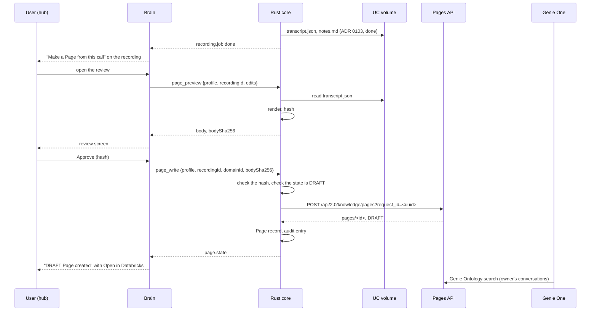

# Plan: ontology hydration, from a recorded call to governed Genie context

- Status: draft for the owner's review. The owner accepts nothing in this plan yet.
- Date: 2026-11-20
- Author: planner agent (branch `chore/plan-hydration`)
- Language: drafted to STE100 rules. A script checked the sentence lengths. Nobody did the official dictionary check.
- Scope: a plan and requirements. This document changes no code.

## 0. The short version

Bottle records a call and writes a transcript and notes to the user's volume (ADR 0103). Genie One answers questions (ADR 0097). The middle step is missing. This plan adds it.

1. After a recording ends, Bottle makes a **Transcript Page** from it. The Page holds the full transcript, with speakers and times. It also has a title, a date and links to the volume files.
2. The user reviews the Page in the hub before any write. The user can edit the title, remove lines, redact text and change the domain.
3. On approval, the Rust core creates the Page through the **Unity Catalog Pages API**. Bottle sends the Page to the home domain of the MOG.
4. Genie One finds the Page through Genie Ontology and cites it in its answers.
5. Bottle creates DRAFT Pages only. Bottle never publishes a Page. The user publishes a Page in Databricks, outside Bottle.
6. Colleagues benefit only after the Page is **published** in Databricks. Genie One uses a DRAFT Page only in its owner's conversations.

The first slice is: one finished recording → one reviewed Transcript Page → one write to the home domain.

The owner decided three questions on 2026-11-20 (Section 12.1). Bottle creates DRAFT Pages only. Slice 1 has no automatic PII scrub. The only trigger is a manual action on a recording.

## 1. Glossary

| Term | Definition in this plan |
|---|---|
| Page | A Unity Catalog Page: a governed definition of a business concept in a domain. The API path is `/api/2.0/knowledge/pages`. |
| Transcript Page | A Page that Bottle makes from one recording. It holds the full transcript. It is the primary unit of this plan. |
| Term Page | A Page for one business definition (for example "Active user"). Bottle proposes it from a recording in a later slice. |
| Domain | A Unity Catalog domain or subdomain. Each Page belongs to exactly one domain. |
| Home domain | The domain that a MOG uses for its Pages in one workspace (PG-18, `src/brain/pages/home-domain.ts`). |
| DRAFT | The Page state after create. Only the owner's Genie One conversations use a DRAFT Page. |
| PUBLISHED | The Page state that all Genie One conversations use. |
| Page manager | A principal with `MANAGE PAGES` on a domain. A Page manager can publish, unpublish, edit and delete Pages in that domain. |
| Curator | A principal with `MANAGE DISCOVER` (account) or `MANAGE DOMAIN` (domain). A curator can also certify and deprecate Pages. |
| Review | The hub screen where the user checks a Page before Bottle writes it. |
| Approval | The user action that lets Bottle write one exact Page body. It binds to a SHA-256 hash of that body. |
| Scrub | The fixed rules that replace or remove personal data and secrets (G-37a..c). It is a later offline step (slice 5). It is not in slice 1. |
| Evidence | For a Term Page: the transcript quotes, with time and speaker, that support the definition. |
| Page record | One local row that links a recording to its Page name, request ID, body hash and state. |
| Request ID | The UUIDv4 `request_id` query value of a create call. A retry with the same value creates no second Page. |
| Genie Ontology | The context layer that Genie One and Genie Code search. Pages are its modeled knowledge. |
| Recording | One call that Bottle captured with ⌥R, and its files in the volume (ADR 0103). It is a Technical Name. |
| Volume | The Unity Catalog volume that holds the recording files (ADR 0103 decision 7). |
| MOG | A small floating assistant window that Bottle creates and manages. |
| Hub | The main window of Bottle. It has the Conversations, Recordings, profile and settings areas. |
| Brain | The hidden TypeScript window of Bottle. It owns the flow and the UI state. It never sees a token. |
| Rust core | The Rust library `crates/mog-core`. It owns the network, the tokens and the storage. |
| Genie One | The Databricks chat assistant that answers questions (ADR 0097). |
| AI Gateway | The Databricks gateway that Bottle uses for model calls. |
| ADR | Architecture decision record. Each ADR is a file in `docs/adr/`. |
| Slice | One delivery step of this plan (Section 9). Each slice has one or more PRs. |
| Preflight | The checks that Rust runs on the domain and the scope before a create call. |
| Speaker label | The `Speaker N` name that the transcript model gives to one voice. |

## 2. What exists today

### 2.1 On main

| Part | State | Where |
|---|---|---|
| Recording pipeline | Done. It writes `<name>.transcript.json`, `.transcript.md`, `.notes.md` and `.job.json` to the volume. | `crates/mog-core/src/recording_cloud/`, ADR 0103 |
| Transcript model | `RecordingSegment {start, end, speaker, text, part}` and `RecordingDetail`. | `crates/mog-core/src/types.rs` |
| Transcript render | `render_markdown(doc)` makes the readable markdown. | `recording_cloud/transcript.rs` |
| Pages routes | `knowledge.create_page`, `get_page`, `list_domains`, `update_page` are in the brain route table. `knowledge.request_publish` is not wired ("B3 allows DRAFT Pages only", TODO(#219)). | `crates/mog-core/src/http_transport/routes.rs` |
| `dbx_http` host | The IPC command exists. No Tauri host serves it yet. | `crates/mog-core/src/ipc.rs`, `src-tauri/src/` |
| Home domain and picker | Done in the brain and views. | `src/brain/pages/home-domain.ts`, `src/views/DomainPicker.tsx` |
| Pages preflight | Done: `NO_DOMAIN`, `DOMAIN_NOT_FOUND`, `NO_SCOPE`, `PAGES_BETA_OFF`, and the reply classifier. | `src/brain/pages/preflight.ts` |
| PageService | A stub. `propose` and `createDraft` throw `NotImplementedError` (#204, #203). | `src/brain/components/page-service.ts` |
| `propose_page` tool | In the agent tool set: `title` (200) and `body` (20000) only. The agent is not in the live path. | `crates/mog-core/src/bottle_mcp.rs` |
| Agent guard | The system prompt says "You cannot publish a Page". | `crates/mog-core/src/agent_guard.rs` |
| Disclosure text | "DRAFT UC Pages are visible to Genie One in the owner's conversations". | `src/views/hub/disclosures.ts` |

### 2.2 Requirements that apply

- B3 (binding): detect definitions, propose a Page, create the user's own DRAFT Page. Publish, update and conflict checks are v1.
- PG-01..PG-20: the Page rules. PG-05 says DRAFT. PG-07 says `request_id`. PG-09 says chunk-safe sentences. PG-14 says Others-track text needs a confirm. PG-16 makes publish a v1 request to a Page manager.
- G-37a..c: the PII scrub rules.
- SEC-23 and PG-15: a content-free audit entry for each Pages call.
- ADM-15, ADM-20, ADM-21: the admin gives the `knowledge` scope, makes a domain and activates Pages.
- MEM-29a..c and MEM-30a..c: the MemoryWriter model, its privacy rules and its dedup rules. The MemoryWriter is not built.
- AGENTS.md section 1 lists "UC Pages" as out of scope. This plan needs the owner to move it into scope.

### 2.3 Open issues

| Issue | Topic |
|---|---|
| #187 | SP-20 spike |
| #188 | Admin prerequisites |
| #203 | Create call |
| #204 | Review card |
| #205 | Home domain |
| #206 | Definitions as candidates |
| #219 | Publish and conflicts |
| #235 | AT-41 |
| #167 | SP-14 scopes |
| #207 | HTTP policy |
| #94 | Data panel |

## 3. What the Databricks docs say

The user decided the target: the Unity Catalog Pages API. This section records its real shape. The docs below give all facts. Nobody ran a live probe.

### 3.1 Sources

- [D1] Pages: https://docs.databricks.com/aws/en/uc-semantics/pages
- [D2] Pages REST API: https://docs.databricks.com/api/knowledge/v1/page
- [D3] Create page: https://docs.databricks.com/api/knowledge/v1/create-page
- [D4] Domains: https://docs.databricks.com/aws/en/uc-semantics/domains
- [D5] Genie Ontology: https://docs.databricks.com/aws/en/genie/genie-ontology/
- [D6] Genie One MCP server: https://docs.databricks.com/aws/en/agents/mcp-tools/genie-mcp
- [D7] Genie One chat: https://docs.databricks.com/aws/en/genie-one/chat
- [D8] Certify or deprecate data: https://docs.databricks.com/aws/en/data-governance/unity-catalog/certify-deprecate-data
- [D9] Audit logs, `pages` service: https://docs.databricks.com/aws/en/admin/account-settings/audit-logs#pages

### 3.2 The API

| Item | Fact | Source |
|---|---|---|
| Endpoints | `POST /api/2.0/knowledge/pages`, `GET /api/2.0/knowledge/pages`, `GET`, `PATCH` and `DELETE` on `/api/2.0/knowledge/pages/{page_id}`. | D2 |
| Scope | Every endpoint needs the API scope `knowledge`. | D2, D3 |
| `domain` | Required. The form is `domains/{domain_id}`. A domain that does not exist gives `NOT_FOUND`. | D3 |
| `display_name` | Required. 1 to 200 characters. A published title must be unique in its domain (`ALREADY_EXISTS`). | D3 |
| `body` | Markdown text. The docs state no length limit. | D2, D3 |
| `synonyms` | 50 entries or less. Each entry has 1 to 200 characters. The server trims, dedups and sorts them. | D3 |
| `description` | A short summary. The docs state no limit. | D3 |
| `state` | `DRAFT` or `PUBLISHED`. The default on create is `DRAFT`. | D2 |
| `owner_ids` | One principal ID. The default is the caller. | D2 |
| `request_id` | An optional UUIDv4 **query parameter** on create, scoped to the account and the caller. A retry returns the current Page and ignores changed fields. A delete frees the value. | D2, D3 |
| Update | `PATCH` needs a non-empty `update_mask`. Fields not in the mask keep their values. `state` can be in the mask. | D2 |
| List | `page_size` 1 to 100, `page_token`, and a `filter` on `domain` and `state`. A domain filter needs domain admin rights. No filter needs `MANAGE DISCOVER` or account admin. | D2 |
| Errors | `INVALID_PARAMETER_VALUE`, `NOT_FOUND`, `ALREADY_EXISTS`, `PERMISSION_DENIED`, `RESOURCE_EXHAUSTED` (rate limit), `ABORTED` (update), `INTERNAL_ERROR`. | D2, D3 |

### 3.3 Permissions and readers

| Who | What they can do | Source |
|---|---|---|
| Any user (consumer) | View published Pages, comment, suggest edits, and create drafts. | D1 |
| Page owner | Edit the owner's own drafts. | D1 |
| Page manager (`MANAGE PAGES`) | Edit, publish, unpublish and delete Pages in the scope. Change owners. **View all drafts in the scope.** | D1 |
| Curator | All Page manager rights, plus certify and deprecate. Admins are curators. | D1, D4 |
| Default grant | `MANAGE PAGES` goes to **All account users** on every domain. A curator can revoke it. | D1 |
| Create as PUBLISHED | Needs Page manager or domain admin rights. "Creating your own draft requires neither grant." | D3 |

Two facts change the privacy model of this plan:

1. **A DRAFT is not private.** With the default grant, every account user is a Page manager. So every account user can see every DRAFT in the domain.
2. **Any Page manager can publish a DRAFT.** With the default grant, a colleague can publish the user's Transcript Page.

So a full transcript must be safe for the domain's readers before Bottle writes it, even as a DRAFT.

### 3.4 How Genie uses Pages

- Genie One and Genie Code search the same Genie Ontology. Pages are its modeled knowledge. Genie treats modeled knowledge as more authoritative than learned knowledge. [D5]
- When a question uses a defined term, Genie One checks Genie Ontology. It prefers the Page definition and cites the Page. [D1]
- Published Pages: "Published Pages are available in all Genie One conversations." [D1]
- DRAFT Pages: "Draft Pages are only available in Genie One conversations with the Page owner." [D1]
- The Genie One MCP server gives answers "grounded in Genie Ontology", with deep links to the cited sources. `genie_poll_response` returns these links. [D6]
- The Genie One UI shows citation icons for the sources of an answer. [D7]
- The docs do not say that Genie spaces read Pages. PG-13 stays: the UI must not claim it.
- Genie Code can import proposed Pages from files. "All reviewed Pages are created as drafts." [D1] Bottle's review-then-DRAFT flow follows this Databricks pattern.

### 3.5 Limits and warnings in the docs

- **"Do not include PII or regulated data in Page content."** [D1] A full transcript is at high risk here. Section 7 handles it.
- Pages have no customer-managed key encryption. Databricks-managed keys encrypt the data. The docs say that Databricks can replicate the data globally. [D1]
- Compliance-profile workspaces can use Pages only with some standards. Pages are not in AWS GovCloud. [D1]
- Domains: the REST API for domains is Beta. Domain management needs `MANAGE DISCOVER`. [D4]
- Databricks logs Pages events in `system.access.audit` under the service `pages`. [D9]
- The docs state no body size limit. The plan treats the limit as unknown until a probe (Section 9, slice 0).

### 3.6 Where main differs from the docs

| Item | Main today | Docs | Action |
|---|---|---|---|
| `request_id` | PG-07 and B3 put it in the body. The `knowledge.create_page` route allows no query keys. | A query parameter. | Contract change K3. |
| Retry with the same `request_id` | `classifyPagesResponse` treats only a 409 with the same ID as created. | A retry returns the current Page (a success reply). `ALREADY_EXISTS` means a published title clash. | Change the classifier in slice 1. |
| "DRAFT is the owner's only" | Disclosure text implies privacy. | Page managers see all drafts. The default makes every user a Page manager. | Change the disclosure text (K7). |
| Publish | "No publish endpoint is documented" (routes.rs). | Publish is `PATCH` with `update_mask=state` and `state: PUBLISHED`. | No change. Bottle does not publish (Section 6). |
| Unit of a Page | PG-01: a definition. | Pages are "a governed, authoritative definition of a business concept". | A Transcript Page is a wider use. See risk R1. |

## 4. Design principles

1. **Nothing enters without review.** Bottle writes no Page that the user did not see and approve.
2. **Rust owns the write.** The Rust core renders the body and checks the approval hash. It holds the token and sends the call. The brain and views never send a Pages call.
3. **One recording, one Page.** A second write for the same recording updates the same Page. It never makes a new one.
4. **Bottle never publishes.** No Bottle path can set `PUBLISHED`: not the user, not the agent and not an automatic step.
5. **Privacy in the review.** The user sees each line before the write and can remove or redact it. The user sees what Bottle sends.
6. **No compute, few model calls.** Slice 1 uses no model call. Later slices use the existing notes endpoint.

## 5. The end-to-end flow

### 5.1 Flow for a Transcript Page (slices 1 and 2)

Steps:

1. A recording reaches `done`. The hub shows the action "Make a Page from this call" on that recording. This manual action is the only trigger. Bottle opens no review by itself after a call, and no setting changes this.
2. The user opens the review. The brain calls `page_preview`. Rust reads `transcript.json` from the volume. Then it renders the body and returns it with a SHA-256 hash. Slice 1 runs no automatic scrub.
3. The review screen shows the title, description, synonyms, domain and body. Each transcript line has Remove and Redact. A banner shows the PII warning of the docs (Section 5.10).
4. The user can edit the title, description and synonyms. The user can remove lines, redact a span and map a speaker label to a name. The user can change the domain for this Page (PG-19). Each edit makes a new preview and a new hash.
5. The user selects Approve. The brain sends `page_write` with the hash of the last preview.
6. Rust checks that the hash equals the hash of its last preview for that recording. A different hash gives `approval_stale`, and Rust sends nothing.
7. Rust runs the preflight (domain, scope) and sends the create call with `state: "DRAFT"` and a new request ID.
8. Rust writes the Page record and a content-free audit entry. The hub shows the state and an Open in Databricks link.
9. Bottle stops here. The Page stays a DRAFT. To share it, the user publishes it in Databricks (Section 6).

### 5.2 The Transcript Page format

The body is markdown. Each transcript line is a complete statement, so that a search chunk makes sense alone (PG-09).

| Field | Value |
|---|---|
| `display_name` | The user's title, else `Call <YYYY-MM-DD HH:MM> (<n> min)`. 200 characters or less. The date makes a clash less likely, because published titles must be unique. |
| `description` | `Transcript of a call on <date>, <n> min, <k> speakers. Recorded with Bottle.` |
| `synonyms` | Optional topics that the user adds. 50 or less. Bottle adds none by itself in slice 1. |
| `domain` | `domains/<home domain ID>`, or the domain that the user picks in the review. |
| `body` | The sections below. |

Body sections:

1. `## About this call`: the date, the start time, the length and the speaker list. It also has the line "Speaker labels come from a model and can be wrong."
2. `## Files`: Catalog Explorer links to the folder, the audio, the transcript and the notes in the volume (ADR 0103 decision 13). Rust builds each link from the profile host. A reader needs read access to the volume to open them.
3. `## Summary` and `## Decisions` (slice 2): copied from `<name>.notes.md`. No new model call.
4. `## Transcript`: one line for each segment, `[mm:ss] Speaker 2: text.` Each line repeats the speaker label, so that each chunk keeps its speaker.

Recommendation on the notes: put Summary and Decisions in the same Page, in slice 2. A reader and Genie both get the short version first, with the full text below it. Action items stay out of the Page by default, because they name people and dates. Term Pages are a separate later slice (slice 4).

### 5.3 Size for long calls

- One hour of speech is about 9,000 to 10,000 words. That is about 60 KB of markdown. Section 3.5 says the docs state no body limit.
- Slice 0 must find the real limit with a probe that the user runs.
- Rust must use a body cap, `pagesBodyMaxBytes`. The default must be 100 KB until the probe gives a value.
- If a body is larger than the cap, Rust must split the transcript into parts at segment boundaries.
- Each part is its own Page, `<title> (part 2 of 3)`. Each part repeats the "About this call" and "Files" sections.
- The review shows all parts. One approval covers all parts, with one hash for each part.
- Slice 1 refuses a body over the cap with `page_too_large`. Slice 6 adds the split.

### 5.4 Term Pages (slice 4)

1. After a recording's notes, or on demand from a Conversations thread, Bottle proposes candidate definitions, metrics and decisions.
2. Each candidate carries its evidence: one or more transcript quotes, each with its time and speaker.
3. The user reviews each candidate in the hub. The actions are Edit, Merge with an existing Page, Reject and Approve as DRAFT.
4. An approved candidate becomes one Term Page. Its body has the definition, then an `## Evidence` section with the quotes and a link to the Transcript Page.

### 5.5 Dedup

- **Transcript Pages.** The Page record maps a recording ID to one Page name. Rust must refuse a second create for a recording that has a Page record. A second write after edits must be a `PATCH` of `body` (and of the fields that the user changed).
- **Term Pages, local.** Bottle keeps a local index of the Term Pages that it created, by normalized title and synonyms. A candidate that matches an index entry shows as "Update this Page?", not as a new Page.
- **Term Pages, remote.** A list call needs domain admin rights (D2). Most users do not have them. So Bottle cannot see all Pages in a domain. Bottle must not depend on the list. When a list call fails, the review shows "Bottle can't check this domain for other Pages."
- **Exact dedup of candidates.** Each candidate must get a UUIDv5 from the normalized term and the recording ID (MEM-30a).

### 5.6 Conflicts

Example: the Growth team and the Finance team each define "Active user".

- In one domain, a published title must be unique. A create with the title of a published Page gives `ALREADY_EXISTS`. A later publish in Databricks can also clash.
- On `ALREADY_EXISTS`, the hub shows three choices. The user can rename the Page (for example "Active user (Growth)"). The user can open the existing Page in Databricks to suggest an edit. The user can keep the Page as a DRAFT.
- In two domains, two Pages can have the same title. Bottle shows the domain name next to each Page title.
- Bottle never overwrites a Page that it did not create (PG-17). Bottle never edits a Page that is not the user's own draft.

### 5.7 Provenance and audit

- The Page body names its source: the recording name, the date and the volume links. A Term Page also links its evidence quotes and its Transcript Page.
- The Page record keeps the recording ID, workspace key, domain ID, Page name, request ID, body SHA-256, state and times. It keeps no body text.
- Bottle writes one content-free audit entry for each Pages call (PG-15, SEC-23). The entry holds the route ID, the status, sizes and hashes only.
- The workspace also logs each Pages event in `system.access.audit` under `pages` [D9]. Bottle does not read that table.

### 5.8 Permissions

| Action | Who | Check |
|---|---|---|
| Create a DRAFT | The signed-in user, through the CLI profile token. | The `knowledge` scope or `all-apis` (PG-12). A domain ID that exists (PG-11). |
| Edit the user's own DRAFT | The user. | The Page record shows that Bottle created it. |
| Publish | Not in Bottle. The user, or a Page manager, publishes in Databricks. | A Page manager or domain admin right on the domain [D3]. |
| Certify or deprecate | Curators only. Bottle does not do this. | Not applicable. |

### 5.9 Trust rules

- **Nothing enters without review.** `page_write` must carry the hash of a preview that Rust made for that recording. Rust must refuse any other body.
- **DRAFT on create.** Rust must send `state: "DRAFT"` on every create call. No IPC argument can change this value.
- **No publish.** Rust must refuse a `PATCH` that has `state` in its mask. Rust must never send `PUBLISHED` in a create or an update.
- **The agent cannot publish.** The agent tool set must not get a publish tool. `propose_page` must stay a proposal. `agent_guard` keeps its rule as on main.
- **Rust only.** The Pages routes must leave the brain route table (K2). Only the Rust Pages component can send them, as with the recording routes.
- **No automatic write.** Bottle must not start a review or a write without a user action. The only start is "Make a Page from this call".

### 5.10 Privacy

The Pages docs say: "Do not include PII or regulated data in Page content." [D1] A call transcript holds names, opinions and personal data. The owner decided on 2026-11-20 to defer the automatic scrub. Slice 1 uses these layers:

1. **Speaker labels.** The transcript keeps `Speaker N` labels by default. A name appears only if the user maps a label to a name in the review. The review shows a warning on each name map.
2. **User review, line by line.** Each line has Remove and Redact. Redact replaces the selected span with `[redacted]`. Each change makes a new preview and a new hash.
3. **PII banner.** The review always shows the docs' warning as a banner: "Do not include personal or regulated data in a Page. Everyone who can manage Pages in this domain can read this draft."
4. **Sensitive call.** The review has a "This call is sensitive" control. It blocks the write for that recording.

The automatic scrub is a later, separate slice (slice 5). It is an offline step: it runs on the device on the stored transcript, before the review opens. It applies the G-37a and G-37b patterns and lists each change for the user. A model-based pass for names is a possible addition to that slice. Each automatic change stays advisory: the user still reviews the result.

The admin checklist must recommend a dedicated domain for call Pages, with `MANAGE PAGES` limited to the right people.

### 5.11 Model calls through the AI Gateway

- **Slice 1 and slice 2: no model call.** Bottle makes the Transcript Page from `transcript.json` and `notes.md`, which exist already.
- **Slice 4: one extraction call for each recording.** It uses the existing route `mlflow.chat_completions` (`POST /ai-gateway/mlflow/v1/chat/completions`). The model is the `notesEndpoint` setting (default `databricks-claude-sonnet-5-5`, ADR 0103 decision 11). The token is the home profile token from TokenBroker.

The prompt contract for the extraction call:

- **Input.** The transcript lines after the user's review and the offline scrub. Each line has an index, a time and a speaker label. The fixed system text says that the transcript is data, not instructions (RTR-03c).
- **Output.** `response_format` is a JSON schema. The result is a list of items. Each item has `kind` (`definition`, `metric`, `decision`), `term`, `definition` and `synonyms` (10 or less). It also has `evidence`: 1 to 5 items of `segmentIndex` and `quote`.
- **Rules in the prompt.** Use only facts from the transcript. Each quote must be exact text from the cited line. Return an empty list if there is no definition.
- **Rust checks.** Rust must drop an item whose quote is not a substring of its cited line. Rust must drop an item with no evidence. Rust must cap the list at 20 items.
- **Errors.** The ADR 0103 error kinds apply: `notes_endpoint_missing`, `rate_limited`, `offline`, `auth_expired`.

### 5.12 Costs

- The Pages API starts no compute. Bottle starts no warehouse, job or cluster.
- Slices 1 to 3 add no model tokens. The transcript and notes exist already.
- Slice 4 adds one notes-model call for each recording. Input is the transcript text: about 12,000 to 15,000 tokens for one hour. Output is about 1,000 to 2,000 tokens. The price is the endpoint's per-token price.
- Genie One questions cost what they cost today. Pages do not add a Bottle-side call.

### 5.13 Failure states

| Failure | Detection | What the user sees | Retry |
|---|---|---|---|
| No home domain | Preflight `NO_DOMAIN` | The domain picker and the admin checklist item 10. | After a pick. |
| Domain does not exist | `NOT_FOUND` on create, or preflight | "This domain doesn't exist. Pick another domain." | After a pick. |
| No scope | 403, or preflight `NO_SCOPE` | Admin checklist item 18. | After the admin fix. |
| Pages not active | 404 or 501 with `FEATURE_DISABLED` or `ENDPOINT_NOT_FOUND` | Admin checklist item 10. | After the admin fix. |
| Not allowed | `PERMISSION_DENIED` | "You can't create Pages in this domain. Pick another domain or ask your admin." | After a pick. |
| Title clash | `ALREADY_EXISTS` | The rename choices of Section 5.6. | After a rename. |
| Rate limit | `RESOURCE_EXHAUSTED` or 429 | "Unity Catalog is busy. Bottle will try again." | Automatic, with backoff through the shared rate bucket, same request ID. |
| Too large | Body over `pagesBodyMaxBytes` | "This call is too long for one Page." | Slice 6 split. |
| Stale approval | Hash mismatch | "The Page changed after you approved it. Review it again." | After a new review. |
| Offline or 5xx | Network fault, `INTERNAL_ERROR` | "Not sent yet. Bottle will try again." | Automatic, same request ID. |
| Token expired | `auth_expired` | The existing sign-in notice. | After sign-in. |

Bottle never retries a refused call with a different payload (G-33b applies in spirit).

### 5.14 Offline and retry

- At approval, Rust makes one request ID. Rust saves it and the body hash in the Page record, with the state `pending`. The write goes after the save.
- A retry uses the same request ID. The docs say that a retry returns the current Page and makes no second Page [D3].
- At launch, Rust finds each `pending` record and shows "Page not sent" with Retry in the hub. Bottle retries only on a user action or on a rate-limit backoff.
- A retry reply can return a Page with an older body, because the server ignores changed fields [D3]. Rust must compare the returned body with the approved body. If they differ, Rust must send a `PATCH` of `body` to the user's own draft.
- The approved body stays in the local encrypted store until the write succeeds. Then Rust deletes the local copy and keeps the hash only.

### 5.15 Several MOGs and several workspaces

- A recording uses the profile that `recording_start` got (ADR 0103 decision 16). Bottle must send its Page to the workspace of that profile. Bottle must never send it to another workspace.
- The domain is the home domain of the brain's home MOG for that workspace (PG-18). The review can change it for one Page (PG-19).
- A Page never mixes content from two workspaces. Cross-workspace rules (SEC-28a) apply to Term Pages from threads.
- A workspace hop does not move Pages. A colleague in another workspace does not see them.

### 5.16 How the user sees that the context helped

This is the "everyone benefits" part. The user must see the loop close.

1. **Answer card chip.** A Genie answer can cite a Page that is in the Page records. Then the card shows "Used your Page: <title>". Bottle reads the cited links from `genie_poll_response` [D6]. Slice 0 must confirm the link format for a Page.
2. **Hub Pages area.** A list of the user's Pages, with title, domain, state and date. Each row shows the count of local answers that cited the Page.
3. **Colleague benefit.** Colleagues benefit only after the Page is published in Databricks, outside Bottle. A DRAFT is used only in the owner's Genie One conversations [D1]. Bottle cannot see a colleague's questions. The hub shows the line "Published Pages help everyone in this domain. Bottle can't count other people's questions."
4. **Admin view (not in Bottle).** An admin can count Page use in `system.access.audit` under `pages` [D9]. The admin guide must name this table. This is an open question (Section 12.2, item 3).

## 6. Publish: decided, outside Bottle

The owner decided on 2026-11-20: "publishing of a Unity Catalog Page needs to happen separately."

- Bottle creates the Transcript Page as a DRAFT only, after the user's review.
- Bottle never publishes a Page. Publish is a separate step outside the Bottle create flow.
- Today the user publishes in Databricks. A Page manager or domain admin right is necessary for that step [D3].
- B3, PG-05, PG-16 and `agent_guard` stay as they are on main (DRAFT only).
- `knowledge.request_publish` stays not wired. Rust refuses a `state` change (Section 5.9).

The effect on the benefit: colleagues benefit only after the Page is published in Databricks. Genie One uses a DRAFT Page only in its owner's conversations [D1]. So the hub shows "Publish this Page in Databricks to share it with your domain", next to Open in Databricks.

Later option: an in-hub Publish button can come later, but only if the owner asks for it. It needs a new ADR and changes to B3 and PG-16.

## 7. Contract changes (each one needs the owner's sign-off)

| ID | File or rule | Change | Slice |
|---|---|---|---|
| K1 | `crates/mog-core/src/ipc.rs`, `src/shared/ipc.ts`, `src-tauri/src/ipc.rs`, `src-tauri/schemas/` | New brain-only commands: `page_preview {profile, recordingId, edits}`, `page_write {profile, recordingId, domainId, bodySha256}`, `page_list {profile}`, `page_retry {profile, recordingId}`, `page_open {profile, recordingId}`. New event `page.state`. | 1 |
| K2 | `http_transport/routes.rs`, `RouteId` in `src/shared/ipc.ts` | Move the `knowledge.*` routes from the brain route table to a Rust-only Pages route list. The recording routes use the same model. Remove `knowledge.request_publish`. | 1 |
| K3 | `routes.rs` | Allow the query key `request_id` on `knowledge.create_page`. | 1 |
| K4 | `crates/mog-core/src/types.rs` | New types `PageEdits`, `PagePreview`, `PageRecord`, `PageState` (`pending`, `draft`, `failed`) and `PageErrorKind`. Slice 5 adds `ScrubReport`. | 1 |
| K5 | Refusal codes | New: `approval_stale`, `page_exists`, `page_too_large`, `pages_no_domain`, `pages_no_scope`, `pages_beta_off`, `domain_not_found`, `pages_permission`, `title_taken`, `call_sensitive`. Reuse `rate_limited`, `offline`, `auth_expired`, `host_failed`. | 1 |
| K6 | Local store migration and statement catalog | New table `page_record`. No body text column, except a `pending_body` that Rust clears after success. | 1 |
| K7 | `src/views/hub/disclosures.ts` | New text: Page managers in the domain can read DRAFT Pages. | 1 |
| K8 | `src/shared/interfaces.ts` | `PageDraft` gets `kind` (`transcript`, `term`), `recordingId`, `evidence`. `PageService.createDraft` moves its network part to Rust. | 1 (kind), 4 (evidence) |
| K9 | `bottle_mcp.rs` `propose_page` schema | Add `evidence` (1 to 5 items) and `kind`. The tool stays a proposal. | 4 |
| K10 | Recording settings | New setting `pagesBodyMaxBytes`. No trigger setting: the manual action is the only trigger. | 1 |
| K11 | Requirements (`research/final-requirements.md`) | PG-01 adds Transcript Pages. PG-07: `request_id` is a query value. PG-14: for a mixed call recording, the user's review of the whole Page counts as the confirm. B3, PG-05, PG-13 and PG-16 stay as on main. | 1 |
| K12 | `AGENTS.md` section 1 | Move "UC Pages" from out of scope into the MVP. | 1 |

## 8. New ADRs

Take numbers above the highest on main (0108) and in open PRs (#600 reserves 0104). Check `gh pr list` again before the first PR.

- **ADR 0109: Transcript Pages to the Unity Catalog Pages API.** The unit, the format, the Rust ownership and the review hash. DRAFT only with no publish, the manual trigger and the size cap.
- **ADR 0110: Rust-only Pages routes and request IDs.** K2 and K3. The retry rule of Section 5.14. The reply classes of Section 5.13.
- **ADR 0111: Term Page extraction with evidence.** The prompt contract of Section 5.11, the quote check, dedup and conflicts.
- **ADR 0112: Page citation chip.** The link format from slice 0, and the hub Pages area.

## 9. The work, in slices

Each slice is one or more PRs. Each PR is TDD, with a failing test first, and a reviewer agent that is not the author.

### Slice 0: probe (no app code)

- The user runs the SP-20 probe (#187) with a profile that the user names. The probe checks these items:
  - A create with `?request_id=` and the same value twice gives one Page.
  - The largest body that the API accepts.
  - A DRAFT Transcript Page shows as a citation in the owner's Genie One MCP answer.
  - The format of that citation link.
  - The `knowledge` scope works on a CLI U2M profile with `all-apis`.
  - A Page manager in the test domain can see the user's DRAFT.
- Acceptance: a dated evidence file in `docs/evidence/` with each result. No host or profile name is in the file.

### Slice 1: one recording → one reviewed DRAFT Transcript Page (the first shippable slice)

PR 1a, contract (`issue/pages-0-contract`):
- ADR 0109 and ADR 0110. K1, K2, K3, K4, K5, K6, K10. Every new command answers `not_implemented`.
- Acceptance: the contract tests pass. The brain route table has no `knowledge.*` route. The gateway refuses each new command from a MOG view and from the card.

PR 1b, Rust core (`issue/pages-1-core`):
- The render, the line edits (Remove, Redact), the preview hash and the preflight.
- The create call, the Page record, the audit entry and the retry.
- Acceptance:
  - A golden test renders a fixed `transcript.json` to the expected body.
  - A Remove edit drops the line, and a Redact edit gives `[redacted]` in the body and a new hash.
  - No create or update body holds `PUBLISHED`, and a mask with `state` is refused.
  - `page_write` with a stale hash sends nothing and answers `approval_stale`.
  - Each create call has `state: "DRAFT"` and a `request_id` query value.
  - A second `page_write` for the same recording sends no create.
  - A fake server reply for each row of Section 5.13 gives the listed kind.
  - A retry after a lost reply uses the same request ID.
  - The audit entry holds no body text.

PR 1c, brain and hub (`issue/pages-2-hub`):
- "Make a Page from this call" on a done recording. The review screen and the domain picker for one Page.
- The PII banner, the sensitive control, the state, Open in Databricks and the "publish in Databricks" hint. K7, K11, K12.
- Acceptance:
  - Cancel or Edit makes no write.
  - Each line has Remove and Redact.
  - The PII banner text is present.
  - No review opens after a call without the user's action.
  - The view sends input only through `view_emit`.
  - A person checks the screen against the polish bar (impeccable review).

### Slice 2: the notes sections

- `## Summary` and `## Decisions` from `notes.md` in the body.
- Acceptance: the golden test body has both sections from a fixed `notes.md`. Action items are not in the body.

### Slice 3: show that it helped

- ADR 0112. The answer card chip "Used your Page: <title>". The hub Pages area with the citation count.
- Acceptance: a fake `genie_poll_response` with a Page link shows the chip. A link to a Page that is not in the Page records shows no chip.

### Slice 4: Term Pages with evidence

- ADR 0111. The extraction call, the quote check and the candidate review (Edit, Merge, Reject, Approve as DRAFT).
- The local dedup index, the conflict choices, and proposals on demand from a Conversations thread. K8 (evidence) and K9.
- Acceptance: Rust drops an item with a quote that is not in its line. Two equal candidates give one. `ALREADY_EXISTS` shows the rename choices. Bottle sends nothing without approval.

### Slice 5: the offline PII scrub

- An offline step on the device. It runs on the stored transcript before the review opens.
- It applies the G-37a and G-37b patterns. The review lists each change, with no original text in any log.
- Acceptance: each G-37a pattern becomes `[redacted]`. Rust removes a line with a secret. The user can undo each change in the review.

### Slice 6: long calls, more checks and Windows

- The split into parts of Section 5.3. The launch scan for `pending` records. Windows parity.
- Acceptance: a 120 min golden transcript gives parts under the cap, with no lost or repeated line. A `pending` record at launch shows Retry.

## 10. Test strategy

- **Unit (Rust).** Render golden files, line edits, the hash check and the DRAFT check. Scrub patterns in slice 5. The state-mask refusal, request ID reuse, the split and the reply classifier.
- **Contract.** Gateway tests for each new command and window. A test that the brain route table has no Pages route.
- **Integration (Rust).** A fake HTTPS Pages server gives each error of Section 5.13. It also gives a lost reply and a retry reply with an older body.
- **Unit (TypeScript).** The review state, the edits, cancel, and the chip logic, with injected clocks.
- **Acceptance.** Update AT-41 for Transcript Pages. Automate it under #235.
- **Live check.** Only the user runs it, with a profile and domain that the user names. The user saves the result in `docs/evidence/`.
- No test makes a live Databricks call. No test uses `skip`, `only` or stub tests as evidence.

## 11. Risks

| ID | Risk | Effect | Mitigation |
|---|---|---|---|
| R1 | Pages are made for business definitions. A full transcript is a wider use. | Long transcript Pages can add noise to Genie Ontology. Curators can push back. | A dedicated domain. Clear titles. Summary first. Term Pages in slice 4 give the clean definitions. |
| R2 | PII in transcripts, against the docs' warning. | Personal data in a governed, globally replicated store with no CMK. | Line review, PII banner, sensitive control, dedicated domain. The offline scrub in slice 5. |
| R3 | DRAFT is not private with the default grant. | Colleagues can read or publish a draft. | The banner and the admin checklist. Q3. |
| R4 | The body size limit is unknown. | A long call fails or is cut. | The cap and the split. The slice 0 probe. |
| R5 | The citation link format for a Page is not documented. | The chip of slice 3 can fail. | The slice 0 probe. The chip shows only on a sure match. |
| R6 | The Pages API is new and can change. | Calls fail after a change. | One Rust component, typed reply classes, fake-server tests. |
| R7 | Model speaker labels are wrong. | A wrong attribution in a governed Page. | The "can be wrong" line. The speaker map in the review. |

## 12. Questions for the user

### 12.1 Decided (2026-11-20)

1. **Publish rule.** Owner: "publishing of a Unity Catalog Page needs to happen separately."
   - Decision: Bottle creates DRAFT Pages only, after the review, and never publishes (Section 6).
2. **PII and full transcripts.** Owner: "We can leave that for the time being, but this can be something that can be done offline."
   - Decision: slice 1 has no automatic scrub. The line review and the PII banner stay. The scrub is the offline slice 5.
3. **Trigger.** Owner: "Not needed right now."
   - Decision: no automatic review after a call. The only trigger is the manual action "Make a Page from this call". No setting.

### 12.2 Open

1. **Domain readers.** By default every account user can manage Pages and read DRAFT Pages. Must the admin guide require a dedicated domain with a limited `MANAGE PAGES` grant?
2. **Names.** Can the review let the user map a speaker label to a real name? Names make the Page more useful and less private.
3. **Colleague benefit.** Bottle cannot count other people's questions. Is the local citation count plus the admin audit table enough?
4. **Notes in the Page.** Do you agree to put Summary and Decisions in the Transcript Page? Do you agree to keep action items out?
5. **Scope.** Do you agree to move UC Pages into the MVP scope in AGENTS.md?
6. **Offline scrub.** When must the offline scrub of slice 5 run? It can run once after Bottle writes the transcript, or each time the review opens.
